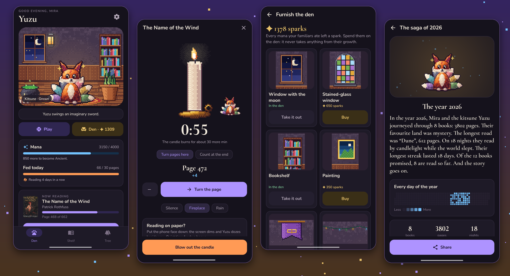
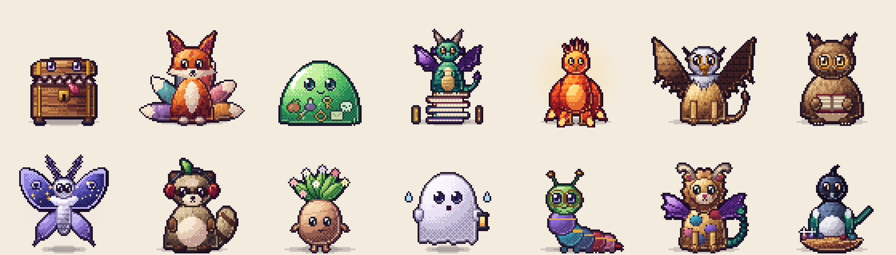
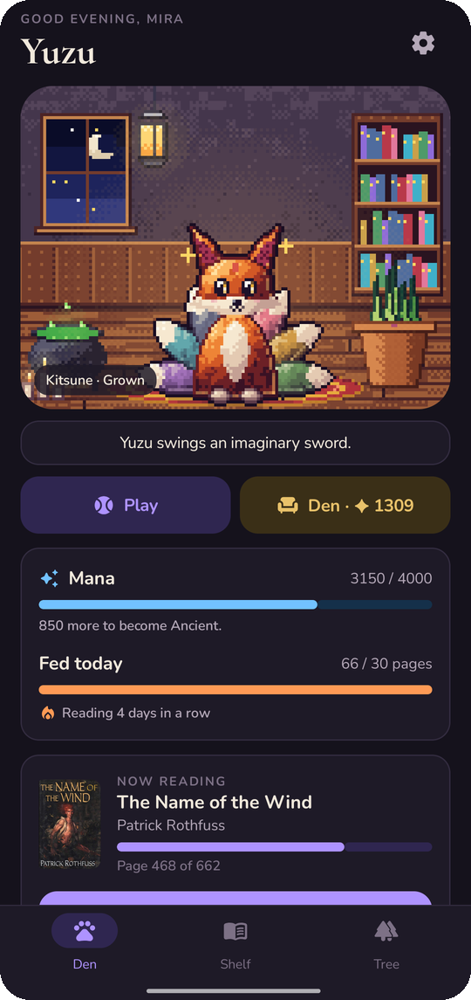
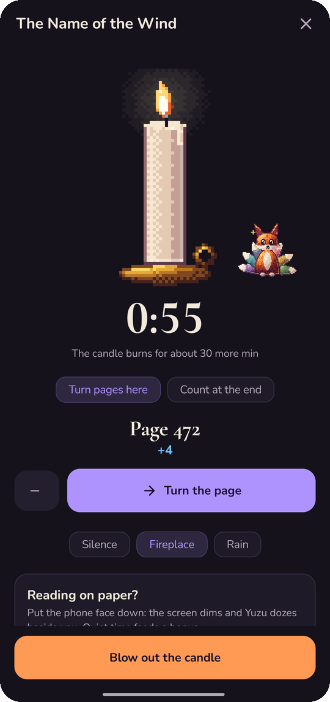
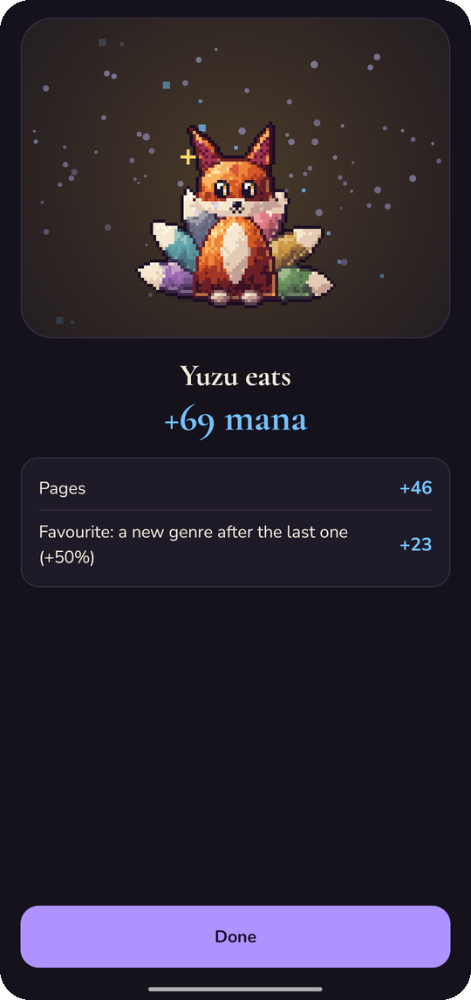
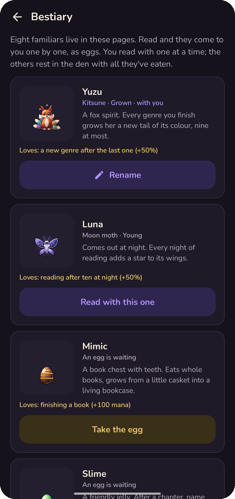
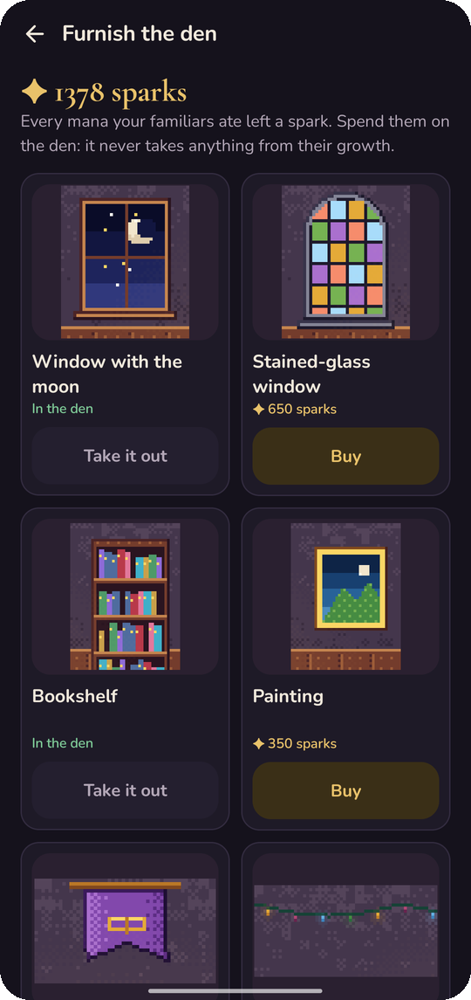
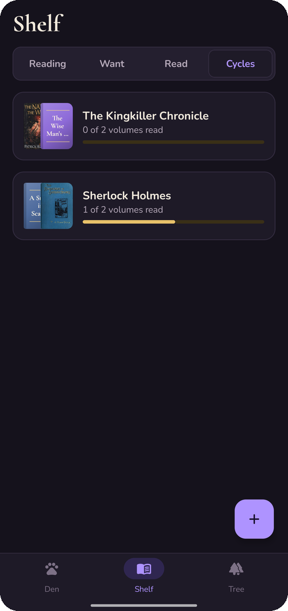
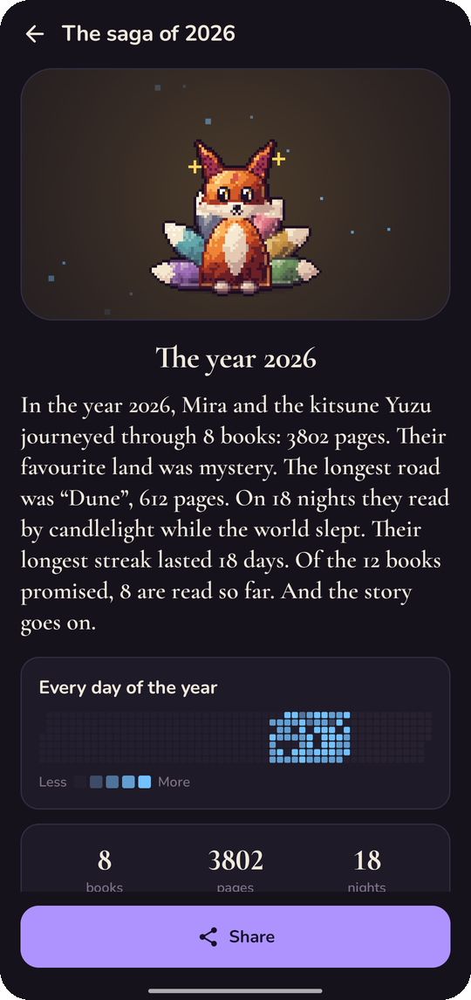

<div align="center">


# Familiar

### A familiar that feeds on stories

*A reading tracker with a pixel-art pet. Every page you read is mana; your familiar eats it, hatches, grows and learns. Free, no ads, no account.*

[](https://github.com/bigdevwhale/familiar/actions/workflows/android.yml)
[](https://github.com/bigdevwhale/familiar/releases/latest)


[](LICENSE)

**English** · [Русский](README.ru.md) · [Website](https://bigdevwhale.github.io/stillcraft/apps/familiar/) · [Changelog](CHANGELOG.md)



</div>

---

## The idea

You are a reading mage, and every mage needs a familiar. Yours lives on mana, and mana comes from pages. Read and it hatches from an egg, grows through five stages and changes with what you read. Forget about books and it slowly turns to stone, from the paws up, until a few pages break the spell.

## The familiars



All the art is pixel art painted by the app itself (shaded shapes, hue-shifted ramps, dither, rim light), so every familiar shows what *you* read:

| | Familiar | Loves | Grows |
|---|---|---|---|
| 📦 | **Mimic** | finishing a book | from a little chest to a chest of books with a crown jewel |
| 🦊 | **Kitsune** | a new genre after the last one | a tail in each finished genre's colour, up to nine |
| 🟢 | **Slime** | things from books | swallows one thing you name after a chapter (a sword, a letter…), and you see it inside |
| 🐉 | **Dragon** | long books | sits on a hoard of the books you finished |
| 🔥 | **Phoenix** | coming back after a pause | never turns to stone: burns to ash and rises again |
| 🦅 | **Griffin** | reading streaks | its wings spread wider every stage |
| 🦉 | **Owlbear** | non-fiction and history | spectacles, then a scholar's mantle |
| 🦋 | **Moon moth** | reading after ten at night | a star on its wings for every night of reading |

Three can hatch at the start; the other five are found by reading (a 400-page book, five late nights, seven days in a row, a non-fiction or history book, a comeback after a pause). About one egg in sixteen hatches **shining**, in a rare colouring: a moonlit kitsune, an ice phoenix, a snowy owlbear.

## The den


Your familiar lives in a little pixel room. Every mana it ever ate leaves a **spark**, and sparks buy furniture: a window with the real day or night in it, stained glass, a bookshelf filled with the colours of your finished books, a bubbling cauldron, a mandrake that peeks out of its pot, a telescope, fairy lights, rugs, candles, a lantern. Spending sparks never takes anything from growth.

Stroke the familiar and it squeezes its eyes shut and purrs; toss it a ball of yarn once a day. After midnight it sleeps and snores, and a tap wakes it for a sleepy moment.

<br clear="right" />

## What's inside

| | Feature | How it works |
|---|---|---|
| 🕯️ | **The ritual** | A candle that burns down while you read, a big "turn the page" button with a rustle, or just read and say where you stopped at the end. A synthesised fireplace or rain. Lay the phone face down and the familiar dozes on your lap; quiet time feeds a bonus. |
| 🎧 | **Audiobooks** | Counted in minutes: a gramophone turns instead of a candle, and every minute listened counts by itself. |
| ✍️ | **Log pages** | Read on the train? Tell it where you stopped and it eats those pages too. |
| 🍖 | **The feast** | After each sitting: pages, candlelight, stillness, the familiar's favourite, a finished book. Too many pages in too little time and it sniffs at them suspiciously. |
| 🎭 | **Moods** | After horror it trembles, after romance it blushes, after a mystery it squints, after non-fiction it puts on spectacles. |
| 🔎 | **Find a book** | Search Open Library (Google Books as a fallback) by title or author: the title, author, pages and the real cover fill in. Covers are kept on the phone. Or type it in and get a cover drawn in the genre's colour. |
| 📚 | **Cycles** | Give books a cycle and a volume number; the volumes gather together, and reading the whole cycle earns a reward. |
| 🌳 | **Tree of stories** | Every finished book grows a glowing fruit in its genre's colour. Tap one to open the book. |
| 🎯 | **Goal for the year** | How many books this year, with how far ahead of or behind the pace you are. |
| ⚔️ | **The guild** | Three monthly errands, the same for every reader, none of them a must. |
| 📖 | **Saga** | Your year told as a legend, with a square for every day of reading, ready to share. |
| 🔔 | **Reminder and widget** | An evening line from your familiar, quiet on days you've read; a home-screen widget with the familiar and today's pages. |

<table>
  <tr>
    <td></td>
    <td></td>
    <td></td>
    <td></td>
  </tr>
  <tr>
    <td></td>
    <td></td>
    <td></td>
    <td></td>
  </tr>
</table>

## Download

Get **Familiar.apk** from the [latest release](https://github.com/bigdevwhale/familiar/releases/latest) and open it on your phone (allow installing from your browser or file manager when asked). Android 8.0 or newer.

Some phones (Xiaomi, Huawei, Samsung) stop apps in the background: allow autostart and lift battery limits for Familiar so the evening reminder arrives.

## Privacy

No account, no ads, no analytics. The app goes online only when you search for a book and to download its cover; your reading stays on the phone unless you export a backup.

## Build

```bash
./gradlew testDebugUnitTest     # unit tests
./gradlew assembleDebug         # app.familiar.dev, installs next to a release
./gradlew assembleDebug -Pdemo  # app.familiar.demo with ten weeks of made-up reading, for screenshots
./gradlew testDebugUnitTest -Prender --tests '*RenderArt*'   # sprite sheets to app/build/art, launcher icons
```

The sprites live in `app/src/main/java/app/familiar/ui/pix`: `Pix.kt` is the shading toolkit, `Sprites.kt` holds the eight familiars and their eggs, `Room.kt` the den and its furniture, `Scenes.kt` the candle, the gramophone and the tree.

## License

[MIT](LICENSE). Part of [Stillcraft](https://bigdevwhale.github.io/stillcraft/).
