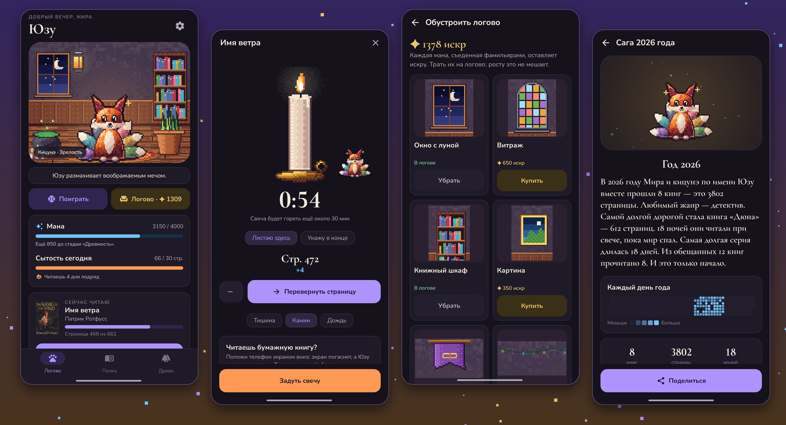
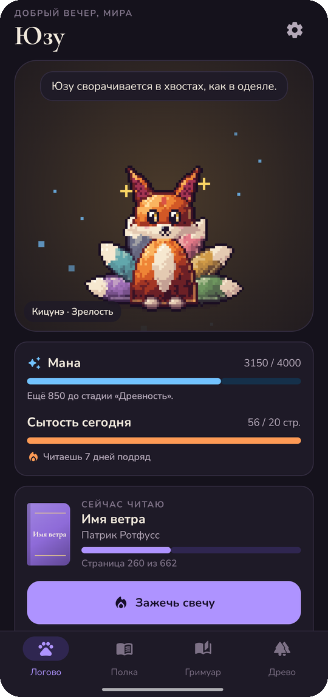
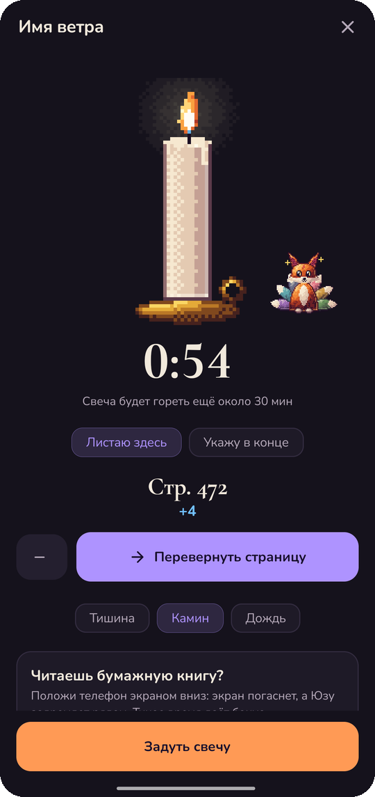
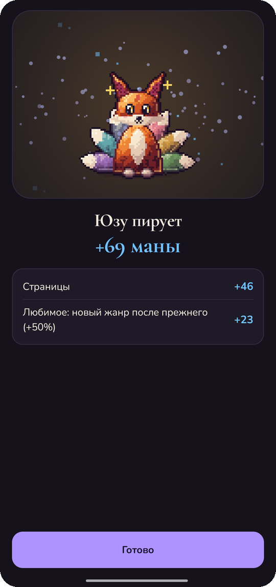
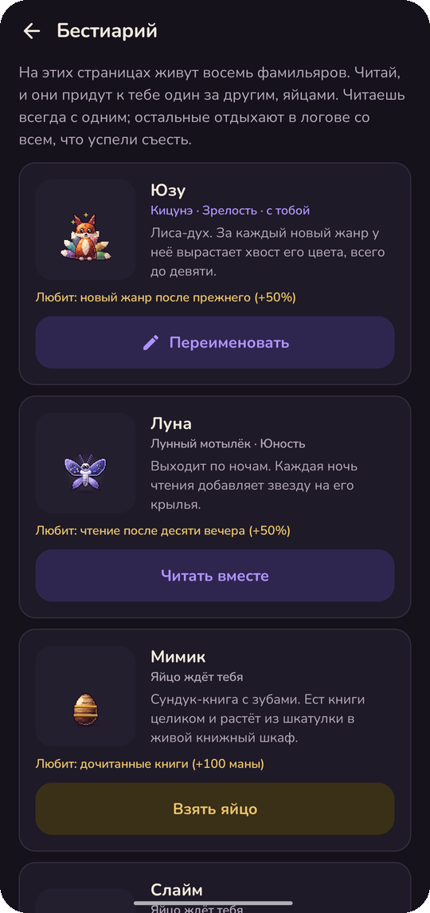
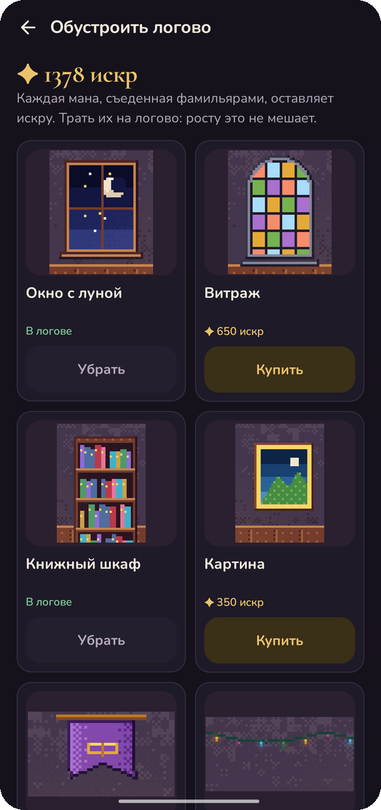
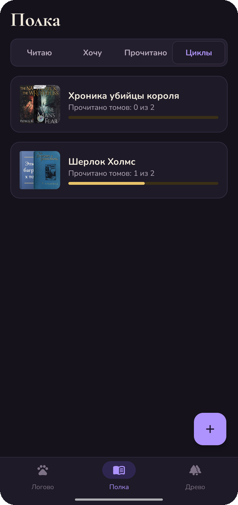
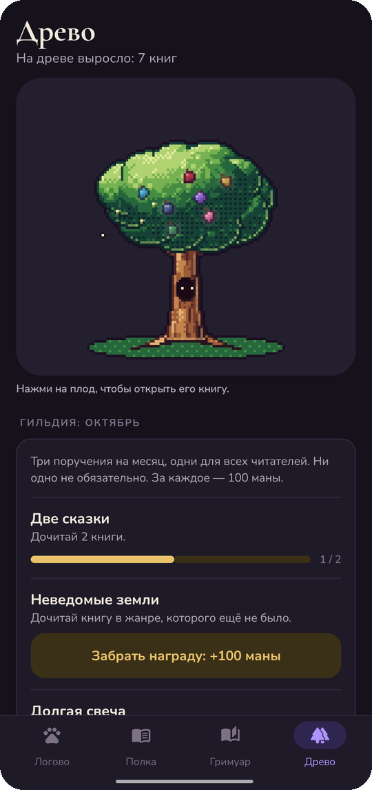
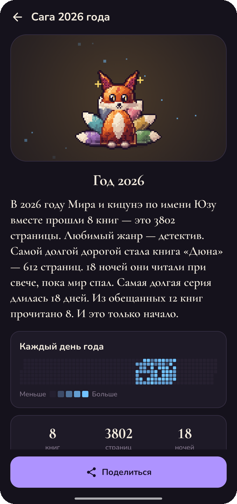

# Фамильяр

### Фамильяр, который питается историями

*Трекер чтения с пиксельным питомцем. Каждая прочитанная страница — мана; фамильяр её ест, вылупляется, растёт и учится. Бесплатно, без рекламы и аккаунта.*

[English](README.md) · **Русский** · [Сайт](https://bigdevwhale.github.io/stillcraft/apps/familiar/) · [Изменения](CHANGELOG.md)

---

## Идея

Ты — маг-читатель, а у каждого мага есть фамильяр. Твой питается маной, а мана берётся из страниц. Читай, и он вылупится из яйца, пройдёт пять стадий и изменится от того, что ты читаешь. Забудешь о книгах, и он медленно окаменеет, от лап вверх, пока несколько страниц не снимут чары.

## Фамильяры

Весь арт пиксельный, и рисует его само приложение, поэтому каждый фамильяр показывает именно твоё чтение:

| | Фамильяр | Любит | Растёт |
|---|---|---|---|
| 📦 | **Мимик** | дочитанные книги | из сундучка в сундук, полный книг, с самоцветом на крышке |
| 🦊 | **Кицунэ** | новый жанр после прежнего | хвост цвета каждого дочитанного жанра, до девяти |
| 🟢 | **Слайм** | вещи из книг | глотает вещь, которую ты назовёшь после главы, и её видно внутри |
| 🐉 | **Дракончик** | длинные книги | сидит на горе дочитанных книг |
| 🔥 | **Феникс** | возвращения после перерыва | не каменеет: сгорает в пепел и восстаёт |
| 🦅 | **Грифон** | чтение много дней подряд | крылья шире с каждой стадией |
| 🦉 | **Совомедведь** | нон-фикшн и историю | очки, потом мантия учёного |
| 🦋 | **Лунный мотылёк** | чтение после десяти вечера | звезда на крыльях за каждую ночь чтения |

Трое могут вылупиться в начале; остальных пятерых находишь, читая. Примерно одно яйцо из шестнадцати вылупляется **сияющим**, в редком окрасе: лунная кицунэ, ледяной феникс, снежный совомедведь.

## Логово

Фамильяр живёт в маленькой пиксельной комнате. Каждая съеденная мана оставляет **искру**, а искры покупают мебель: окно с настоящими днём и ночью, витраж, шкаф с корешками цвета твоих дочитанных книг, котёл с зельем, мандрагору, которая выглядывает из горшка, телескоп, гирлянду, ковры, свечи, фонарь. Росту это не мешает.

Погладь фамильяра пальцем вбок, и он зажмурится и замурлычет. После полуночи он спит и сопит, а если тапнуть, сонно приоткроет глаз.

 

## Что внутри

- **Ритуал:** свеча сгорает, пока ты читаешь; кнопка «перевернуть страницу» с шелестом или просто чтение и страница в конце; камин или дождь. Телефон экраном вниз — фамильяр дремлет у тебя на коленях, а тихое время даёт бонус.
- **Читаю или слушаю:** любую книгу можно переключать между текстом и аудиоверсией от сессии к сессии. Вместо свечи крутится граммофон, минуты засчитываются сами, страница в тексте по желанию. Книги только в аудио считаются в минутах.
- **Записать чтение** без приложения: страница, на которой остановка, или просто минуты чтения или прослушивания.
- **Пир** после чтения с подсчётом маны; если страниц подозрительно много, фамильяр принюхивается.
- **Настроение** от жанра: дрожит после ужасов, краснеет после романа, щурится после детектива.
- **Поиск книги** в Open Library (запасной вариант — Google Books): название, автор, страницы и настоящая обложка. Обложки хранятся на телефоне. Можно выбрать свою картинку из галереи или оставить нарисованную обложку цвета жанра. Число страниц необязательно.
- **Свои полки** (одна книга может лежать на нескольких) и **циклы:** укажи у книги цикл и номер тома, тома соберутся вместе, а за весь цикл — награда.
- **Древо историй** с плодом за каждую книгу, **цель на год** с графиком, **гильдия** с тремя поручениями на месяц.
- **Сага** года с квадратиком за каждый день чтения.
- Вечернее напоминание от лица фамильяра и виджет на главный экран.

<table>
  <tr>
    <td></td>
    <td></td>
    <td></td>
    <td></td>
  </tr>
  <tr>
    <td></td>
    <td></td>
    <td></td>
    <td></td>
  </tr>
</table>

## Скачать

**Familiar.apk** в [последнем релизе](https://github.com/bigdevwhale/familiar/releases/latest). Android 8.0 и новее. На Xiaomi, Huawei и Samsung разреши автозапуск и сними ограничения батареи, чтобы приходило вечернее напоминание.

## Приватность

Без аккаунта, рекламы и аналитики. В интернет приложение ходит только при поиске книги и за её обложкой; твоё чтение остаётся на телефоне.

## Лицензия

[MIT](LICENSE). Часть [Stillcraft](https://bigdevwhale.github.io/stillcraft/).
